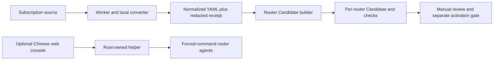

# OpenClash Sync Guard

[简体中文](README.zh-CN.md) · [Deployment guide](docs/DEPLOYMENT.md) · [Security policy](SECURITY.md)

OpenClash Sync Guard is an opinionated, fail-closed toolkit for normalizing a subscription, building a per-router OpenClash candidate, and exposing an optional Chinese operations console. Its safe default is **prepare only**: a successful run writes a Candidate and receipts, but does not change the active configuration, UCI, the scheduler, or the OpenClash service.

> This is infrastructure software, not a universal one-click installer. Read the deployment gates, render your own topology, and inspect every generated file before running a root script.

## What it provides

- A memory-only Python worker that pins the subscription host, rejects redirects and schema drift, and emits a redacted receipt.
- A Ruby Candidate builder with safe YAML loading, structural budgets, closed group/rule checks, DNS handling for hostnames and IP literals, and `HOLD` on drift.
- Separate keys and Candidates for two routers, with serial rollout guidance.
- An optional Chinese web console with Digest SHA-256 authentication, bounded request parsing, a root-owned helper, and forced-command router agents.
- A strict TOML renderer that replaces only documented example topology values and refuses to overwrite an existing output directory.



## Quick start: offline validation

Run on a development Mac or Linux host; these commands do not contact a router or change a live service.

```sh
python3 -m venv .venv
. .venv/bin/activate
python -m pip install -r openclash-sync-web/requirements.txt
./tools/run_offline_checks.sh
```

Create a private local configuration. The example uses RFC 5737 documentation addresses and an intentionally invalid core hash.

```sh
cp config.example.toml config.local.toml
# Edit every value. Never commit config.local.toml.
python3 tools/render_config.py config.local.toml --output build/rendered
(cd build/rendered && sha256sum -c SHA256SUMS)
```

On macOS, use `shasum -a 256 -c SHA256SUMS` for the last command. Rendering does not deploy or activate anything.

## Supported assumptions

- Worker: Python 3.12, PyYAML 6.0.2, a local converter on `127.0.0.1:25500`, OpenSSH, and optionally systemd for the web console.
- Router: OpenWrt/ImmortalWrt with OpenClash, POSIX `sh`, Ruby/Psych, Lua with LuCI modules, `jsonfilter`, `flock`, `curl`, and Dropbear tools.
- The Candidate builder contains opinionated Maying/Nexitally group and filename rules. Adapt and test them before using another provider or ruleset.
- The web console is plain HTTP. Bind it only to a trusted management network or use the included SSH tunnel. A reviewed TLS reverse proxy must set matching explicit `OPENCLASH_WEB_ALLOWED_HOSTS` and `OPENCLASH_WEB_ALLOWED_ORIGINS`; never solve an Origin error with a wildcard.
- Installers require a single pinned Ed25519 host-key line, strict owner/mode checks, root-controlled directory chains, and byte-for-byte post-copy verification. A HOLD is drift evidence, not a prompt to delete or chmod blindly.

## Safety boundary

`ROUTER_STAGE=PASS` means only that a Candidate was generated, hashed, and accepted by the local Mihomo syntax check. It is not evidence of production traffic, runtime health, or authorization to activate. This repository intentionally contains no automatic Candidate activation workflow.

Never commit subscription URLs, raw YAML, passwords, HA1 files, private keys, `known_hosts`, cookies, tokens, or real topology files. See [SECURITY.md](SECURITY.md) and the [detailed deployment gates](docs/DEPLOYMENT.md).

## Audit status

The initial public release was reviewed on 2026-08-16 with offline unit/integration tests, ShellCheck, Bandit, pip-audit, Lua parsing, manifest verification, and a sensitive-data scan. See the [sanitized audit report](docs/SECURITY-AUDIT-2026-08-16.md). This is not a formal third-party penetration test.

## License

MIT. See [LICENSE](LICENSE).
